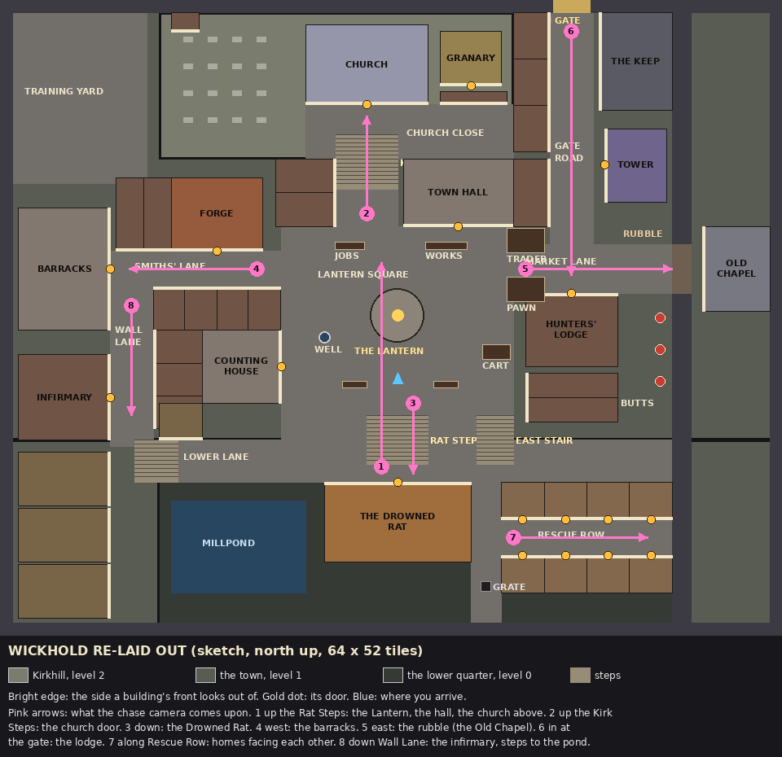

# Wickhold re-laid out

Kyle, 2026-11-15 (new-look.md, "The town re-organised"): "all the houses are facing the same way and on the same
elevation in town. Not very town like." Lanes running different ways, fronts facing their lanes, changes of level,
landmarks placed for the chase camera to come upon. Dense and overlapping, as in `ref/concept-squares.png` and
`ref/dense-town-day.png`.

A new town map behind `?street` (with `?hd`). The old Wickhold stays exactly as it is for everyone else.

The sketch (`ref/town-layout-sketch.png`, drawn by `scripts/townsketch.py` from the plan's numbers): north up, 64 by
52 tiles (today's town is 62 by 40). Bright edge: the side a front looks out of. Gold dot: a door.

## The shape of it

A walled town on a slope: the church on a hill at the top, the square in the middle, the tavern and the poor end
down by the millpond.

- **Kirkhill (level 2), the top.** The church at the head of the Kirk Steps, its front looking down them; the
  graveyard beside it; Church Close, a flagged yard in front; the granary's plot (when the north fields are farmed).
- **The town (level 1).** Lantern Square in the middle, big (19 by 16), the Last Lantern on its dais, the job board,
  the works, the Roll, the well, the market stalls at its east corner. The town hall on its north side, its back to
  Kirkhill's wall, its front on the square. Lanes out of it every way:
  - **Smiths' Lane** west: the forge on its north side, a row of town houses facing it on the south, the barracks
    across its end, front looking down the lane.
  - **Wall Lane** south from there along the west wall: the infirmary and cottages facing it, then a slope down to
    the lower quarter.
  - **Market Lane** east: the hunters' lodge on its south side, the butts behind, the rubble in the east wall at
    its end; once cleared, the Old Chapel is what you see through the gap.
  - **Gate Road** north to the north gate, the keep and the mage's tower on its east side facing it, a row of narrow
    houses on its west side.
  - The counting house on the square's west side, its front on the square.
- **The lower quarter (level 0), the bottom.** Down the Rat Steps or the East Stair from the square's south edge,
  which is a parapet looking over it. The Lower Lane runs along the foot of the wall. The Drowned Rat at the foot of
  the Rat Steps, front looking up them; the sewer grate in the alley beside it (Cobb, Whisper's back door); the
  millpond to the west; Rescue Row to the east, its eight homes in two rows facing each other across the row.
- **The Old Quarter** past the east wall, as now.

Every building's door stays the same interior: same door ids, same people inside.

## What the chase camera comes upon

Each landmark sits where a lane or stair ends, front-on to it, so walking that way the camera swings round to it
(the pink arrows):

1. **Up the Rat Steps** (and where you arrive, on the square's south side): the Lantern, the town hall behind it,
   the church on its hill above. The money shot.
2. **Up the Kirk Steps:** the church door, lit.
3. **Down the Rat Steps:** the Drowned Rat, its tankard sign, firelight in the door.
4. **West along Smiths' Lane:** the barracks; the forge glowing on your right.
5. **East along Market Lane:** the rubble; later the Old Chapel through the gap.
6. **In at the north gate:** straight down the Gate Road to the hunters' lodge door, the square opening on the right.
7. **Along Rescue Row:** homes facing each other, washing behind.
8. **Down Wall Lane:** the infirmary's sign, then the slope to the pond.

## Fronts face their lanes

A block's `face` already says which way you walk in (shared/arena.ts `pushDir`, `doorAt`). The front looks the
other way: no face (or N) fronts south, S fronts north, W fronts east, E fronts west. Houses with no door get a
face too, so the kit knows which side wears the front picture.

The kit today puts every front on the south side (three/streetkit.ts `kitBlock`). Turning the row to the block's
face is the Buildings and camera chat's ("fronts on the swing's sides", on their list); this map gives every block
its face for them to turn to.

## Density

Town houses packed along every lane, no door, a front on their lane (the kit's facades are about 2.2 tiles wide and
7 tall, so a row of them reads as a street). Gaps between the landmarks filled, never a lane or a doorway. About 45
buildings against today's 20. Cottages (single storey, Kyle's note) down Wall Lane and by the pond. The interiors
chat sizes insides from these outsides after.

## Levels

Today a ledge is one level up (0 or 1). The town needs three: the lower quarter 0, the town 1, Kirkhill 2.

- `Ledge` gains an optional `lv` (default 1): stacked ledges, the level you stand on is the highest one under
  you. Steps (ramps) work as now: inside one you go freely between the two levels it joins. From below, a higher
  level's edge is a wall; walk off one and you drop. Every existing map has no `lv` and behaves exactly as now.
- Drawn in 2.5D at `lv` times the ledge height (0.75 tiles, so Kirkhill stands 1.5 tiles over the square), its edge a
  stone retaining wall, its steps drawn as steps. Buildings, street things and townsfolk standing on a level drawn
  up on it (they're drawn at the ground today). Heroes already are.
- The flat view still draws one level up; `?street` is 2.5D only.

## Everyone else's things in the new town

Other chats' people, rounds, marks and animals are placed in their own files by today's coordinates (townlife.ts,
pastimes.ts, publicworks.ts, statue.ts, mend.ts, siege.ts, ground.ts). Rather than copy or edit them, the new map
**moves them by district** (layoutmove.ts): today's town is cut into districts (the square, the forge's front, the church and its
graves, Rescue Row, the millpond, the butts, the barracks' yard, the Old Quarter...), each with where it goes in the
new town and a quarter turn if it's turned (the barracks and the infirmary now front east, the Drowned Rat north).
Whatever stands in a district goes with it: the smith stays at his anvil before the forge, the pots stay by the
church door, Judd's crew in the square. What falls in no district is left out and listed in the log. New things
added to those files later come along by the same rule.

The guards' rounds (Sergeant Dunn, Watchmen Hob and Pike, Orla) are redrawn on the new lanes.

## The switch

`?street` on the screen that holds the room picks the new town (online, the host's; a joiner sees the host's town).
`townMap`, `townSpots` and `TOWN_PROPS` ask the switch; nothing else changes for anyone without it. When Kyle's
happy, the switch comes out and this is Wickhold.

## Slices

1. **Levels.** `Ledge.lv` (arena.ts, a few lines), drawn at height with steps (the Buildings and camera chat's ground.ts, asked first),
   buildings, things and townsfolk lifted to their level. Tests: up and down steps, a drop off an edge, a wall
   from below, old maps unchanged.
2. **The new map behind `?street`.** `shared/layoutplan.ts` (the layout: buildings, levels, steps, lanes' ground,
   walls, water), `layoutmove.ts` (districts), `layouttown.ts` (the map from the world). Tests: every spot, door
   and standing person reachable from where you arrive; the rounds on clear lanes; nothing in a lane or doorway;
   every door the same interior as today's.
3. **Screenshots** along the eight views, then tune with Kyle.

## Open, for Kyle

- Three levels, Kirkhill 1.5 tiles over the square: enough, or taller walls in town?
- Arriving on the square's south side, looking north (view 1). Or in at the north gate?
- The training yard is open ground in the north-west corner, as now. Keep, or pack it with the barracks' outbuildings?
